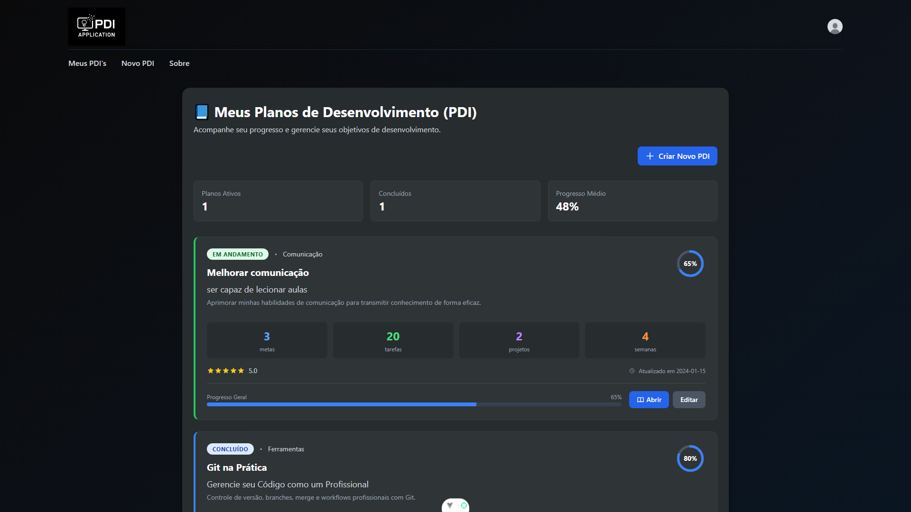
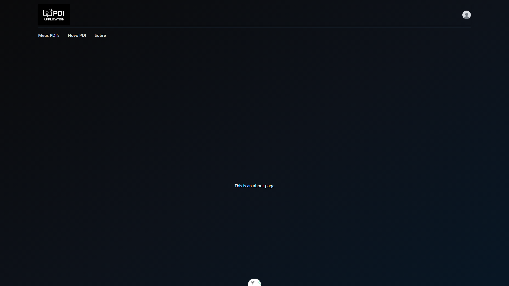
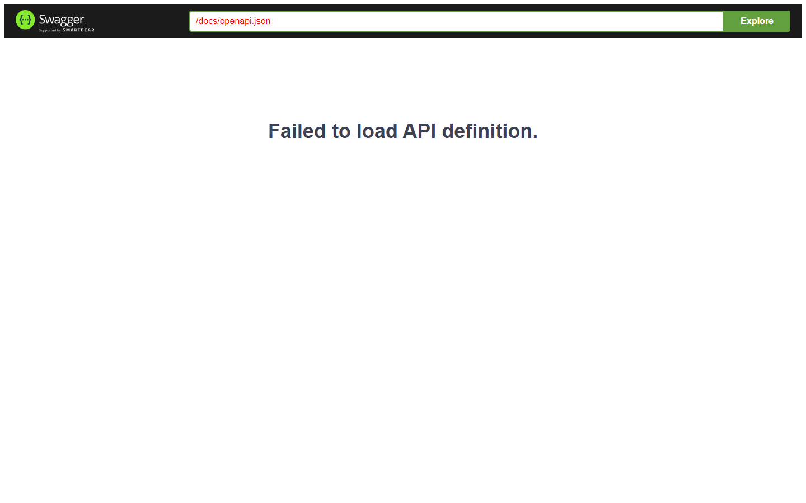
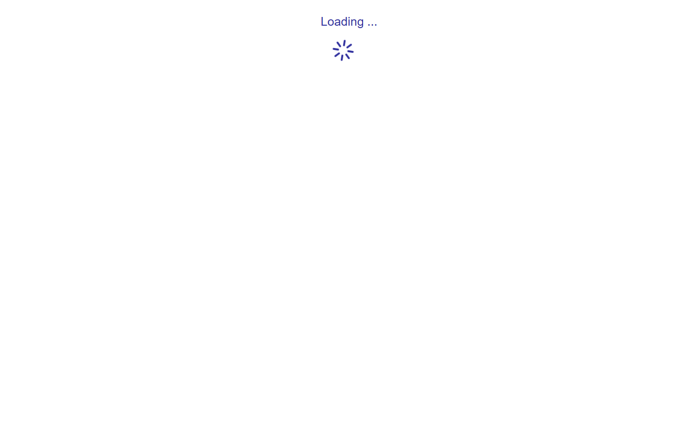

# 💻 PDI Frontend — Interface SPA para Plano de Desenvolvimento Individual

> **Single Page Application construída em Vue 3, Vite, Pinia e Tailwind CSS para acompanhamento visual de competências, metas e planos de carreira.**

[](https://vuejs.org/)
[](https://vitejs.dev/)
[](https://tailwindcss.com/)
[](https://pinia.vuejs.org/)
[](LICENSE)

---

## 📌 Visão Geral

O **PDI Frontend** é a interface web da plataforma de Plano de Desenvolvimento Individual. Desenvolvido com foco em usabilidade e performance, o sistema oferece navegação fluida via Vue Router, painéis com Tailwind CSS, gestão de estado reativo com Pinia e integração com o backend RESTful (`BackendPDI` / `PdiApi`).

---

## 📸 Demonstração Visual

| Tela Inicial da SPA | Sobre a Plataforma |
|:---:|:---:|
|  |  |

| Documentação Swagger do Backend | Documentação Redoc do Backend |
|:---:|:---:|
|  |  |

---

## ✨ Funcionalidades Principais

- 🎯 **Gestão Visual de Metas:** Acompanhamento de objetivos de carreira e competências profissionais.
- 🎨 **Estilização com Tailwind CSS:** Design responsivo, tipografia limpa e layout adaptável.
- ⚡ **Build Ultrarrápido com Vite:** Hot Module Replacement (HMR) e carregamento instantâneo.
- 🧩 **Arquitetura Componentizada:** NavBar desacoplada e componentes reutilizáveis em `src/components/`.
- 🔗 **Integração com Backend API:** Projetado para consumir a API RESTful em `http://localhost:5002`.

---

## 🛠️ Tecnologias Utilizadas

- **Framework:** [Vue 3](https://vuejs.org/) (Composition API)
- **Build Tool:** [Vite 7](https://vitejs.dev/)
- **Estilização:** [Tailwind CSS 3.4](https://tailwindcss.com/) & PostCSS
- **Estado Global:** [Pinia](https://pinia.vuejs.org/)
- **Roteamento:** [Vue Router](https://router.vuejs.org/)
- **Porta Padrão:** `http://localhost:5173`

---

## 📁 Estrutura de Pastas

```bash
PDI/
├── assets/
│   └── screenshots/                 # Capturas da interface e documentação
│       ├── preview.png              # Tela inicial
│       ├── about.png                # Página sobre
│       ├── swagger.png              # Swagger da API
│       └── redoc.png                # Redoc da API
├── PDI/
│   ├── src/
│   │   ├── components/common/
│   │   │   └── NavBar.vue           # Barra de navegação responsiva
│   │   ├── router/                  # Rotas do Vue Router
│   │   ├── stores/                  # Gerenciamento de estado Pinia
│   │   ├── views/                   # Páginas da aplicação
│   │   ├── App.vue                  # Componente raiz
│   │   └── main.js                  # Inicialização
│   ├── tailwind.config.js           # Configurações do Tailwind
│   ├── vite.config.js               # Configurações do Vite
│   └── package.json
└── README.md
```

---

## ⚙️ Pré-requisitos

- **Node.js** v20.x ou superior
- **BackendPDI** rodando em `http://localhost:5002` (opcional para consumo de dados)

---

## 🚀 Como Executar Localmente

```bash
# 1. Navegar até a pasta da aplicação
cd PDI

# 2. Instalar dependências
npm install

# 3. Iniciar servidor na porta 5173
npm run dev
```

Acesse em: `http://localhost:5173`

---

## 📄 Licença

Distribuído sob a licença MIT. Consulte `LICENSE` para mais informações.
